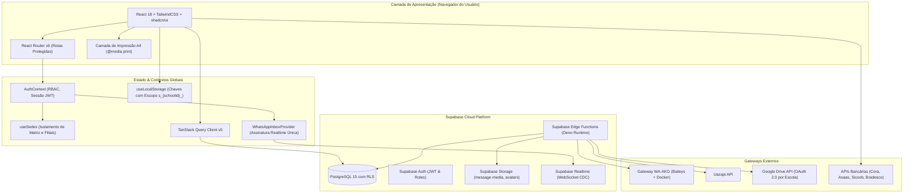
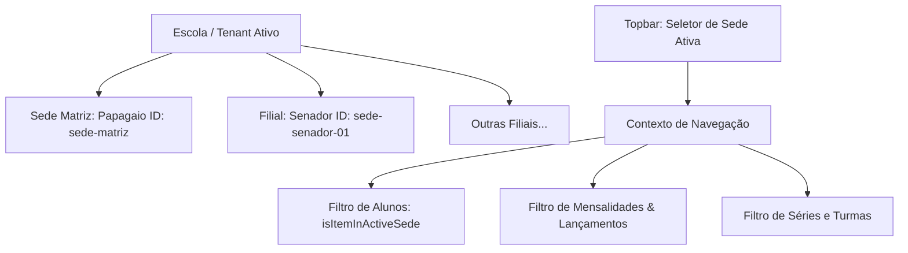

# 🏛️ 01. Arquitetura e Engenharia de Software

Este documento detalha as decisões arquiteturais, padrões de design, diretrizes de segurança e a infraestrutura tecnológica do **Purple Edu**.

---

## 1. Visão Arquitetural Macro

O sistema adota uma arquitetura em camadas orientada a serviços e componentes reativos, combinando processamento distribuído no cliente (SPA React), persistência em nuvem (Supabase BaaS) e gateways especializados para mensageria WhatsApp e emissões bancárias.



---

## 2. Princípios Fundamentais de Engenharia

### 2.1 Multi-Tenancy com Isolamento Estrito
- Toda operação de leitura e gravação no banco de dados deve pertencer a uma escola (`school_id`).
- As tabelas relacionais no PostgreSQL utilizam **Row Level Security (RLS)** onde as políticas verificam se `auth.uid()` pertence ao `school_id` da linha alvo.
- No frontend, para evitar que dados de uma escola ou filial vazem para outra no mesmo navegador, as chaves de persistência utilizam prefixos obrigatórios vinculados ao ID da escola ativa.

### 2.2 Arquitetura Híbrida de Armazenamento (Offline-First / Cache Local)
Para garantir desempenho ultrarrápido (tempo de resposta inferior a 50ms) e tolerância a instabilidades de rede, o sistema opera com armazenamento híbrido:
1. **Cache Local com Escopo (`src/hooks/useLocalStorage.ts`)**:
   - As chaves de armazenamento local recebem a assinatura: `s_${schoolId}_${key}`.
   - Dados como turmas ativas, lista de alunos, lançamentos financeiros e eventos de calendário são carregados instantaneamente do cache local.
   - Quando o usuário altera a escola ou sede ativa, o contexto atualiza as chaves sem reutilizar dados prévios de outras unidades.
2. **Sincronização em Nuvem (`src/lib/cloudState.ts`)**:
   - Alterações críticas são replicadas na tabela `app_state` e nas tabelas relacionais do Supabase.
   - Em caso de login em um novo dispositivo, os dados são hidratados da nuvem automaticamente.

---

## 3. Regras Arquiteturais Críticas (Diretrizes AGENTS.md)

Para manter a integridade operacional e a segurança dos dados, as seguintes regras são aplicadas rigorosamente:

> [!IMPORTANT]
> 1. **Centralização de Estado do WhatsApp**: Todo o estado da caixa de entrada do WhatsApp deve residir centralizado no `WhatsAppInboxProvider`. Uma página ativa mantém estritamente **uma única assinatura realtime** e um único conjunto de queries.
> 2. **Setup do Webhook Uazapi Estrito e Read-Only**: O setup de webhooks deve ser explícito. As verificações periódicas de status devem ser estritamente somente-leitura para não disparar chamadas repetidas e custosas aos servidores do provedor.
> 3. **Persistência Única de Mensagens Inbound**: Cada ID de mensagem do provedor (`message_id`) é persistido exatamente uma vez. O roteamento de mensagens recebidas é resolvido apenas através da instância configurada para a escola em questão, preservando o isolamento de tenant.
> 4. **Normalização e Cópia de Mídias Recebidas**: URLs de imagens, áudios e vídeos fornecidas por provedores de WhatsApp são temporárias e expiram rapidamente. O sistema obrigatoriamente copia essas mídias para o bucket `message-media` no Supabase Storage sob o caminho `escola/conversa/{media_id}` antes de renderizá-las no chat.
> 5. **Mídias Pedagógicas Exclusivamente no Google Drive**: Documentos didáticos, planos de aula e arquivos pesados são armazenados exclusivamente na pasta da escola no Google Drive através de upload direto resumável no navegador. As credenciais de OAuth residem exclusivamente no servidor (Edge Function), garantindo que nenhuma escola acesse arquivos de outra.
> 6. **Consentimento OAuth do Google Drive em Callback Same-Origin Público**: O fluxo de autorização do Google Drive opera em callback público na mesma origem com `state` de uso único mantido em servidor e tokens criptografados, tornando a conexão independente do estado da sessão do usuário e imune a ataques de replay.

---

## 4. Controle de Acesso Baseado em Perfis (RBAC)

O controle de autorização é implementado de forma granular em duas camadas: **Camada de Rotas** e **Camada de Ações/UI**.

### 4.1 Papéis de Acesso (`AppRole`)

```typescript
// src/types/auth.ts
export type AppRole = 'teacher' | 'secretary' | 'admin' | 'director' | 'seller';
```

- **`director`**: Diretor geral ou mantenedor da escola. Possui acesso total e irrestrito a todas as telas, relatórios, cadastros, exclusão de dados e configurações de instâncias.
- **`teacher`**: Professor regente. Acessa exclusivamente a aba Pedagógico, suas próprias turmas, diário de classe e lançamento de notas. Não visualiza financeiro, contratos ou conversas de outros setores.
- **`secretary`**: Secretaria escolar. Gerencia matrículas, emissão de documentos, fichas de alunos, CRM e conversas do setor da Secretaria.
- **`admin`**: Gestor administrativo e financeiro. Administra contas a pagar e receber, mensalidades, boletos, colaboradores e estoque.
- **`seller`**: Vendedor ou atendente comercial. Acessa o pipeline de vendas Kanban, leads e agendamentos.
- **`superadmin`**: Mantenedor master da plataforma SaaS (visão entre todas as escolas cadastradas).

### 4.2 Matriz de Mapeamento de Permissões

```typescript
// src/hooks/usePermissions.ts
export const ROLE_PERMISSIONS: Record<AppRole, Permission[]> = {
  director: [
    'dashboard', 'pedagogico', 'diario', 'turmas', 'alunos', 'matriculas',
    'documentos', 'secretaria', 'mensagens', 'mensagens_todos_setores',
    'setores', 'administrativo', 'financeiro', 'relatorios', 'configuracoes',
    'usuarios', 'comercial', 'estoque'
  ],
  teacher: ['pedagogico', 'diario', 'turmas'],
  secretary: [
    'dashboard', 'turmas', 'alunos', 'matriculas', 'documentos',
    'secretaria', 'mensagens', 'comercial', 'estoque'
  ],
  admin: [
    'dashboard', 'administrativo', 'financeiro', 'relatorios',
    'mensagens', 'comercial', 'estoque', 'usuarios'
  ],
  seller: ['comercial']
};
```

---

## 5. Arquitetura Multi-Sedes (`useSedes.ts`)

Para redes escolares que contam com uma Matriz e filiais (ex.: Unidade Papagaio, Unidade Senador), o sistema provê um subsistema dedicado em `src/hooks/useSedes.ts`:



### Regras de Isolamento de Sedes:
1. **Identificador Canônico**: Cada aluno ou lançamento carrega `sedeId` e `unidade`.
2. **Compatibilidade Retroativa com Matriz**: Registros legados que não possuem `sedeId` explícito pertencem automaticamente à `matrizSede` (`sede-matriz`).
3. **Novas Sedes / Filiais Limpas**: Quando o usuário cria uma nova sede (ex.: "Interagir"), o seletor filtra estritamente por aquela unidade. Dados de outras sedes não são exibidos.
4. **Zerar Unidade & Ações em Massa**: Na tela de Alunos (`src/pages/Alunos.tsx`), diretores contam com o botão seguro **"Zerar Unidade"** e **"Excluir Selecionados"**, permitindo expurgar dados de teste sem afetar as demais filiais da rede.

---

## 6. Camada de Apresentação e Regras de Impressão A4

O frontend foi desenvolvido priorizando interfaces claras, modernas e funcionais:
- **Tailwind CSS**: Esquema visual em tons de roxo (`#7C3AED`), índigo e cinzas suaves.
- **Componentes Acessíveis**: Baseados em primitivos WAI-ARIA com Radix UI.
- **Padronização para Impressão Gráfica A4 (`@media print`)**:
  - Para documentos oficiais (Contratos, Carteirinhas, Calendário Escolar e Recibos), aplicam-se regras estritas:
  ```css
  @page {
    size: A4 portrait;
    margin: 8mm;
  }
  @media print {
    body {
      -webkit-print-color-adjust: exact;
      print-color-adjust: exact;
    }
    .print\:hidden {
      display: none !important;
    }
  }
  ```
  - Headers, barras de navegação, modais de busca e botões são automaticamente suprimidos na saída impressa ou PDF.

