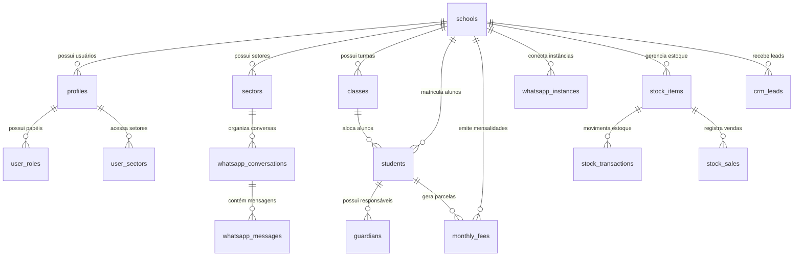

# 🗄️ 02. Banco de Dados e Serviços de Backend

Este documento descreve a modelagem relacional, políticas de segurança Row Level Security (RLS), o catálogo de Edge Functions e a infraestrutura de armazenamento no **Supabase**.

---

## 1. Diagrama Entidade-Relacionamento (ERD)

A estrutura relacional foi projetada em torno do conceito de multi-tenancy, onde a entidade `schools` atua como raiz de isolamento:



---

## 2. Catálogo de Tabelas Principais

### 2.1 Núcleo de Usuários e Tenants
- **`schools`**: Entidade central de cada instituição.
  - Campos: `id (uuid)`, `name`, `document (CNPJ)`, `created_at`, `status`, `subscription_plan`, `drive_connected`.
- **`profiles`**: Perfil estendido vinculado ao `auth.users` do Supabase Auth.
  - Campos: `id (uuid)`, `school_id (uuid)`, `full_name`, `avatar_url`, `phone`, `is_active`.
- **`user_roles`**: Papéis de acesso de cada usuário na escola.
  - Campos: `id`, `user_id`, `role (teacher | secretary | admin | director | seller)`, `created_at`.
- **`sectors`**: Departamentos internos da escola (Secretaria, Financeiro, Coordenação).
  - Campos: `id`, `school_id`, `name`, `whatsapp_instance_id`, `color`.
- **`user_sectors`**: Tabela associativa que define quais setores o atendente/secretária pode visualizar.

### 2.2 Gestão Acadêmica e Alunos
- **`students`**: Cadastro integral do estudante.
  - Campos: `id`, `school_id`, `sede_id`, `name`, `registration_number`, `birth_date`, `status`, `medical_info`, `class_id`.
- **`guardians`**: Cadastro de pais e responsáveis financeiros/pedagógicos.
  - Campos: `id`, `school_id`, `name`, `cpf`, `phone`, `email`, `address`.
- **`classes`**: Turmas e séries da escola.
  - Campos: `id`, `school_id`, `name`, `grade_level`, `year`, `shift (Matutino/Vespertino/Integral)`, `room`.
- **`calendar_events`**: Eventos letivos, feriados e reuniões.
  - Campos: `id`, `school_id`, `title`, `type`, `start_date`, `end_date`, `is_school_day (boolean)`, `target_audience`.

### 2.3 Financeiro e Mensalidades
- **`monthly_fees`**: Parcelas de cobrança escolar.
  - Campos: `id`, `school_id`, `sede_id`, `student_id`, `due_date`, `amount`, `discount`, `penalty`, `status (pending | paid | overdue)`, `payment_method`, `pix_code`, `barcode`, `paid_at`.
- **`financial_transactions`**: Livro caixa e fluxo financeiro contábil.
  - Campos: `id`, `school_id`, `type (income | expense)`, `category_id`, `cash_register_id`, `amount`, `date`, `description`.
- **`cash_registers`**: Contas bancárias e caixas físicos (Cora, Sicoob, Cofre).

### 2.4 Central de Mensagens WhatsApp
- **`whatsapp_instances`**: Credenciais de conexão com provedores (WA-AKG, Uazapi, Evolution).
  - Campos: `id`, `school_id`, `instance_name`, `provider`, `status`, `phone_number`.
- **`whatsapp_conversations`**: Fios de conversa por contato e setor.
  - Campos: `id`, `school_id`, `sector_id`, `contact_phone`, `contact_name`, `last_message_at`, `status (open | resolved)`.
- **`whatsapp_messages`**: Mensagens de texto, áudio e mídias.
  - Campos: `id`, `school_id`, `conversation_id`, `provider_message_id`, `direction (inbound | outbound)`, `message_type`, `body`, `media_url`, `created_at`.

---

## 3. Segurança a Nível de Linha (Row Level Security - RLS)

Todas as tabelas possuem `ENABLE ROW LEVEL SECURITY`.
Exemplo da política de proteção de isolamento de tenant em `students`:

```sql
CREATE POLICY "Tenant isolation for students"
ON public.students
FOR ALL
USING (
  school_id IN (
    SELECT school_id FROM public.profiles WHERE id = auth.uid()
  )
)
WITH CHECK (
  school_id IN (
    SELECT school_id FROM public.profiles WHERE id = auth.uid()
  )
);
```

---

## 4. Catálogo de Edge Functions (Deno Runtime)

O diretório `supabase/functions/` abriga 12 funções serverless dedicadas a tarefas que demandam privilégios de service role ou chamadas de API externas:

| Função | Finalidade e Regra de Negócio |
| :--- | :--- |
| **`create-user`** | Cria novos usuários no Auth da escola, atribui perfil e papéis sem deslogar o administrador ativo. |
| **`update-user-email`** | Atualiza com segurança o e-mail cadastral de um colaborador da escola. |
| **`update-user-password`** | Redefine senhas de usuários respeitando permissões administrativas. |
| **`create-guardian-access`** | Gera credenciais simplificadas de primeiro acesso para pais no Portal da Família. |
| **`signup-with-school`** | Orquestra a criação atômica de uma nova escola, perfil da diretora e instâncias iniciais. |
| **`super-admin`** | Operações privilegiadas do mantenedor da plataforma SaaS (gestão global de tenants e faturamento). |
| **`daily-financial-report`** | Cron job diário que calcula receitas, inadimplência e compila relatórios para a diretoria. |
| **`evolution-api`** | Encaminha comandos de envio de mensagem de texto e mídia para instâncias da Evolution API. |
| **`evolution-webhook`** | Endpoint receptor de webhooks da Evolution API; normaliza eventos de recebimento. |
| **`uazapi`** | Gerencia credenciais da API Uazapi e roteia envios respeitando status de conexão. |
| **`wa-akg`** | Gateway dedicado para comunicação com o container WA-AKG Baileys rodando via Docker. |
| **`google-drive`** | Gerencia o handshake OAuth 2.0 por escola, renova tokens e autoriza uploads resumáveis de arquivos. |

---

## 5. Buckets de Armazenamento (Supabase Storage)

1. **`message-media`** *(Privado com URLs assinadas ou públicas seguras)*:
   - Armazena de forma definitiva fotos, mensagens de voz (áudios OGG/MP3), vídeos e PDFs recebidos ou enviados via WhatsApp.
   - Padrão de pastas: `{school_id}/{conversation_id}/{timestamp}_{filename}`.
2. **`avatars`** *(Público)*:
   - Fotos de perfil de professores, funcionários e alunos.
3. **`pedagogico-drive`** *(Referência interna)*:
   - Metadados de integração com o Google Drive para mídias curriculares.

