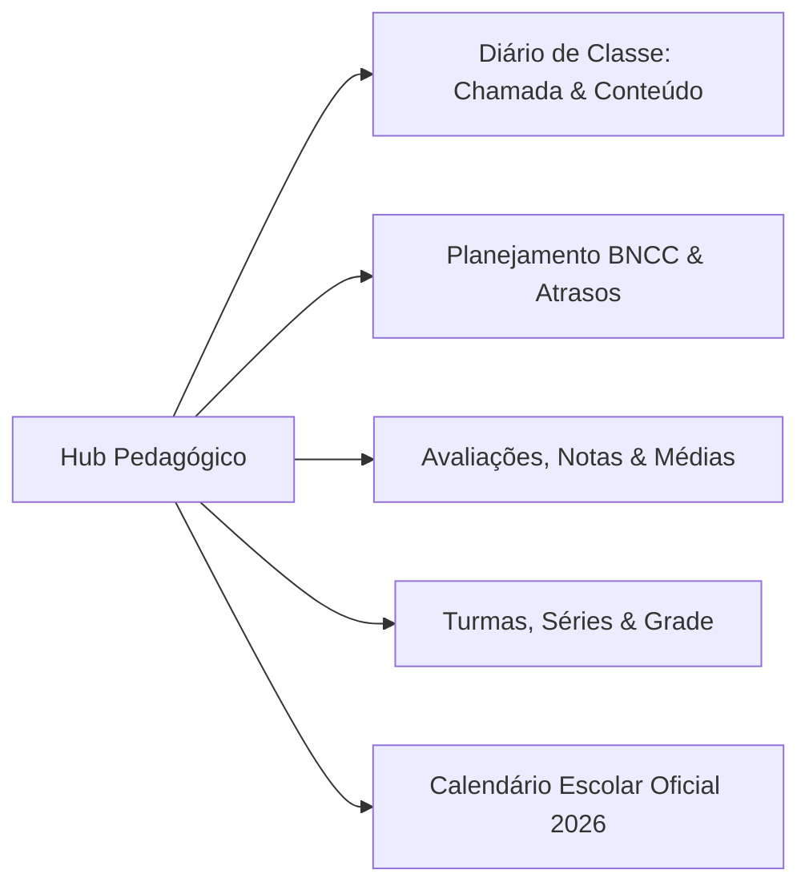

# 🎓 03. Módulo Pedagógico e Gestão Acadêmica

O Módulo Pedagógico é o núcleo acadêmico do **Purple Edu**, estruturado para assegurar conformidade com a Base Nacional Comum Curricular (BNCC), rigor no registro de presença e eficiência no planejamento docente.

---

## 1. Visão Geral do Hub Pedagógico

Localizado em `src/pages/Pedagogico.tsx`, o módulo é composto por abas integradas:

---

## 2. Diário de Classe (`DiarioTab.tsx`)

O Diário de Classe conecta a rotina diária do professor aos registros oficiais da escola:

### 2.1 Registro de Frequência Verídica
- **Lista de Alunos Vinculada**: Carrega em tempo real a lista de alunos da turma e ano letivo ativos.
- **Tipos de Presença**:
  - `P` (Presente) — Verde.
  - `F` (Falta Simples) — Vermelho.
  - `FJ` (Falta Justificada) — Âmbar (permite anexar observação ou atestado médico).
- **Bloqueio Automático em Dias Sem Aula**:
  - Quando a data selecionada coincide com feriado, recesso ou parada pedagógica cadastrada no Calendário Escolar, o sistema bloqueia a chamada e exibe o alerta: *"Dia não letivo registrado no calendário escolar"*.

### 2.2 Conteúdo Programático & Tarefas
- Campos para: Tema da Aula, Conteúdo Desenvolvido, Recursos Didáticos Utilizados e Tarefa de Casa.
- **Disparo em Massa para a Turma**:
  - Botão que formata automaticamente a mensagem do dia e a encaminha via WhatsApp aos responsáveis dos alunos matriculados naquela turma.

---

## 3. Planejamento de Aulas & Detecção Visual de Atrasos (`PlanejamentoTab.tsx`)

O planejamento permite à coordenação pedagógica acompanhar a evolução dos professores:

- **Alinhamento com a BNCC**: Campo para inclusão dos códigos de habilidades da BNCC (ex.: `EF01LP01`, `EI03ET02`).
- **Sistema de Detecção de Atraso Pedagógico**:
  - O sistema calcula a data limite de envio do plano semanal/mensal.
  - Se a data atual for posterior ao prazo e o plano não estiver concluído, o sistema gera alerta em dois níveis:
    1. No próprio planejamento com badge âmbar/vermelho.
    2. No **Calendário do Dashboard da Diretoria** (`src/pages/Dashboard.tsx`), onde o dia letivo correspondente é demarcado com uma **borda vermelha viva** e ícone de advertência.

---

## 4. Avaliações, Notas & Ciclos de Médias (`AvaliacoesTab.tsx`)

O motor de notas do Purple Edu atende a diferentes regimes regimentais escolares:

### 4.1 Fórmulas de Cálculo Configuráveis
1. **Média Aritmética Simples**:
   $$\text{Média} = \frac{N_1 + N_2 + \dots + N_k}{k}$$
2. **Média Ponderada com Pesos**:
   $$\text{Média} = \frac{N_1 \cdot P_1 + N_2 \cdot P_2 + \dots + N_k \cdot P_k}{\sum P_i}$$
3. **Somatória Simples de Pontos**:
   $$\text{Total} = \sum_{i=1}^k N_i$$

### 4.2 Ciclos Avaliativos
- Suporte nativo para **4 Bimestres**, **3 Trimestres** ou **2 Semestres**.
- Trava de valores numéricos de `0.0` a `10.0`.
- Registro de Prova de Recuperação Paralela e Ajuste em Conselho de Classe.
- Geração instantânea do **Boletim Escolar** em formato imprimível e envio digital para o Portal do Aluno.

---

## 5. Calendário Escolar Oficial 2026 & Impressão A4 (`CalendarioEscolarTab.tsx`)

O Calendário Escolar foi homologado para atender tanto à operação diária quanto à exigência de afixação física nos murais da escola e entrega aos órgãos reguladores.

### 5.1 Categorização Cromática Rigorosa
| Categoria de Evento | Cor da Tag | Status Letivo |
| :--- | :--- | :---: |
| **Feriados e Recessos Escolares** | 🔴 Vermelho (#EF4444) | Sem Aula |
| **Paradas Pedagógicas / Planejamento** | 🟠 Âmbar / Laranja (#F59E0B) | Sem Aula |
| **Sábados Letivos / Reposições** | 🟢 Verde (#10B981) | Com Aula |
| **Eventos Culturais & Festividades** | 🟣 Roxo (#8B5CF6) | Com / Sem Aula |
| **Reuniões de Pais e Mestres** | 🔵 Azul (#3B82F6) | Sem Aula |
| **Semanas de Provas e Avaliações** | 🔷 Índigo (#6366F1) | Com Aula |

### 5.2 Botão "Restaurar Feriados 2026"
Injeta com 1 clique todos os feriados nacionais civis e religiosos de 2026 (Ano Novo, Carnaval, Paixão de Cristo, Tiradentes, Dia do Trabalho, Corpus Christi, Independência, N. Sra. Aparecida, Finados, Proclamação da República e Natal), além dos recessos escolares de julho e janeiro.

### 5.3 Impressão Oficial em Formato Anual A4
Ao clicar em **"Imprimir"**, o sistema abre o modal de visualização do **Calendário Escolar Anual**:
- **Grid de 12 Meses**: Renderiza de Janeiro a Dezembro em disposição harmônica de 4 colunas.
- **Isolamento de Impressão (`print:hidden`)**: Oculta menus, sidebars, modais de filtro e cabeçalhos web.
- **Relação Cronológica em Colunas**: Tabela com todas as datas do ano, descrição do evento e público-alvo.
- **Homologação Institucional**: Rodapé com campos para data, carimbo e assinatura da Direção e Coordenação.

