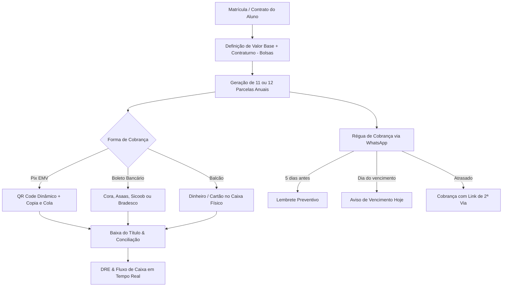

# 💰 04. Módulo Financeiro e Automação de Cobrança

O Módulo Financeiro do **Purple Edu** controla o fluxo de caixa, geração de parcelas, emissão de carnês e a automação da régua de cobrança preventiva e reativa via WhatsApp.

---

## 1. Visão Geral do Fluxo Financeiro

---

## 2. Gestão de Mensalidades e Carnês (`MensalidadesTab.tsx`)

### 2.1 Estrutura do Título de Mensalidade
Cada parcela é calculada pela fórmula:
$$\text{Valor Final} = (\text{Valor Base} + \text{Valor Contraturno}) - \text{Desconto / Bolsa}$$

- **Dia de Vencimento Padrão**: Dia 05, 10, 15 ou configurável por contrato.
- **Competência**: Mês de referência (Fevereiro a Dezembro para 11 parcelas; Janeiro a Dezembro para 12 parcelas).

### 2.2 Operações sobre Mensalidades
- **Baixa Manual**: Permite registrar data de quitação, valor recebido, juros/multa aplicados, desconto concedido e o **Caixa de Destino** (ex.: Cora, Caixa Balcão, Sicoob).
- **Estorno**: Permite reabrir uma mensalidade baixada indevidamente, revertendo o lançamento no livro caixa.
- **Exclusão Individual e em Lote**:
  - Exclusão com diálogo de confirmação seguro para remover cobranças canceladas ou geradas por engano sem corromper o histórico contábil.

---

## 3. Régua de Cobrança Automatizada via WhatsApp

Integrada com as instâncias de mensageria da escola, a régua de cobrança atua em três etapas cronológicas:

1. **Lembrete Preventivo (D-5)**:
   - Enviado 5 dias antes do vencimento com tom cortês, informando o valor e o código Pix para adiantamento.
2. **Aviso de Vencimento (D-0)**:
   - Notificação no dia do vencimento com o link direto da fatura/boleto para evitar que a família esqueça o pagamento.
3. **Cobrança Reativa de Inadimplência (D+3 a D+30)**:
   - Disparo para parcelas com status `overdue`. A mensagem calcula os dias de atraso e oferece facilidades de regularização imediata com nova linha digitável atualizada.

---

## 4. Emissão de Meios de Pagamento

### 4.1 Pix Dinâmico EMV (`generatePixCopiaECola`)
O sistema possui gerador embutido no padrão do Banco Central (EMVCo BR Code):
- Calcula o Payload Format Indicator (`000201`).
- Merchant Account Information com chave Pix (CNPJ, CPF ou Chave Aleatória).
- Merchant Category Code (`0000`) e Moeda (`5303986` para BRL).
- Valor da transação com duas casas decimais.
- Checksum CRC16 padrão polinomial `0x1021`.
- Renderização simultânea do **QR Code visual** (via biblioteca `qrcode`) e do botão de cópia do código Pix Copia e Cola.

### 4.2 Integrações Bancárias

| Gateway Bancário | Arquivo de Serviço | Recursos e Operações |
| :--- | :--- | :--- |
| **Banco Cora** | `src/services/coraService.ts` | Emissão de boletos híbridos (Boleto + Pix), consulta de faturas e webhook de liquidação instantânea. |
| **Asaas** | `src/services/asaasService.ts` | Cobrança por cartão de crédito parcelado, boleto registrado e split de pagamentos. |
| **Sicoob** | `src/services/sicoobService.ts` | Integração via API Open Banking para cooperativas de crédito com emissão de boletos CNAB. |
| **Banco Bradesco** | `src/services/bradescoService.ts` | Registro online de títulos de cobrança corporativa Bradesco Net Empresa. |

---

## 5. Gestão Contábil, Caixas e DRE (`LancamentosTab.tsx`)

### 5.1 Livro Caixa e Contas
- Cadastro de múltiplos caixas:
  - `Caixa Balcão (Secretaria)`
  - `Conta Corrente Cora Tech`
  - `Conta Corrente Sicoob Credi`
  - `Caixa Cantina`
- Lançamento de despesas operacionais divididas em:
  - **Custos Fixos**: Aluguel, energia, internet, folha de pagamento de professores.
  - **Custos Variáveis**: Material de consumo, eventos escolares, manutenção predial, impostos.

### 5.2 DRE Escolar (Demonstrativo do Resultado do Exercício)
- Cálculo consolidado do mês:
  - **Receita Operacional Bruta**: Mensalidades + Matrículas + Vendas Cantina/Uniformes.
  - **Deduções e Bolsas**: Descontos comerciais concedidos.
  - **Despesas Operacionais**: Salários e custos administrativos.
  - **Resultado Líquido do Exercício**: Saldo em caixa gerado no período.

