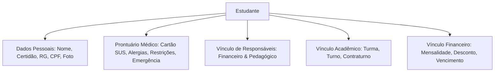

# 📝 05. Secretaria Escolar e Gestão de Alunos

A Secretaria Escolar é a central de relacionamento e conformidade cadastral do **Purple Edu**, responsável pela jornada integral do aluno, desde a matrícula inicial até a expedição de documentos oficiais.

---

## 1. Cadastro 360º do Aluno (`src/pages/Alunos.tsx`)

A ficha cadastral do estudante engloba todos os dados essenciais para o acompanhamento escolar e exigências dos órgãos de ensino:

### 1.1 Prontuário Médico e Cuidados Especiais
- Registro detalhado de:
  - Número do Cartão SUS.
  - Alergias medicamentosas e alimentares (ex.: lactose, glúten, amendoim).
  - Medicamentos de uso contínuo autorizados pela família com receita médica.
  - Telefone de emergência preferencial e pediatra de referência.

### 1.2 Responsáveis Legais e Financeiros
- O sistema permite múltiplos responsáveis cadastrados por aluno (Pai, Mãe, Tutor, Avós).
- Cada responsável pode ser configurado com papéis distintos:
  - **Responsável Financeiro**: Assina os contratos, recebe boletos e carnês, e tem o CPF vinculado à emissão fiscal.
  - **Responsável Didático/Pedagógico**: Recebe comunicações diárias do professor, avisos de faltas e comunicados escolares.

---

## 2. Wizard de Matrícula Inteligente (`MatriculaWizardModal.tsx`)

O processo de matrícula é estruturado em etapas sequenciais guiadas para evitar erros de digitação:

1. **Etapa 1 — Identificação do Aluno**:
   - Nome completo, data de nascimento, naturalidade, número da certidão de nascimento, RG e CPF.
2. **Etapa 2 — Filiação & Responsáveis**:
   - Dados completos dos pais ou responsáveis, endereços residenciais e telefones para contato via WhatsApp.
3. **Etapa 3 — Alocação Acadêmica**:
   - Seleção do Setor (Educação Infantil, Fundamental 1, Fundamental 2, Ensino Médio).
   - Série / Ano e Turma (`A`, `B`, `C`).
   - Turno (`Matutino`, `Vespertino`, `Integral`).
   - Opção de **Contraturno Escolar** (classe de contraturno e turno oposto).
4. **Etapa 4 — Condições Financeiras**:
   - Valor base da mensalidade, valor do contraturno, desconto ou bolsa de estudo.
   - Dia de vencimento preferencial (ex.: dia 10).
   - Quantidade de parcelas contratadas (11 ou 12 parcelas).
   - Taxa de matrícula e material didático inicial.
5. **Etapa 5 — Conclusão & Impressão**:
   - Geração automática das mensalidades no módulo financeiro.
   - Emissão instantânea do **Contrato de Matrícula** e do **Recibo de Quitação**.

---

## 3. Gestão em Massa e Manutenção Multi-Sede

Na tela de Alunos (`src/pages/Alunos.tsx`), a secretaria e a direção possuem ferramentas de alta produtividade:

### 3.1 Transferência em Massa (`TransferirTurmaModal.tsx`)
- Permite selecionar múltiplos alunos com checkboxes e transferi-los simultaneamente de uma turma para outra (ex.: rematrícula anual da turma do 1º Ano A para o 2º Ano A) em um único clique.

### 3.2 Isolamento de Filiais e Recurso "Zerar Unidade"
- **Filtro Estrito por Sede Ativa**: Cada aluno pertence a uma sede (`sedeId` / `unidade`). Ao alternar a sede no Topbar, a lista recarrega exclusivamente os matriculados daquela filial.
- **Botão "Zerar Unidade"**:
  - Exclusivo para Diretores e Super Admins.
  - Permite expurgar registros de demonstração ou vazados acidentalmente de uma sede recém-criada, deixando a nova filial com 0 alunos e pronta para receber os dados oficiais sem afetar a sede matriz.
- **Botão "Excluir Selecionados" & Exclusão Individual**:
  - Exclui os alunos selecionados e suas respectivas parcelas financeiras após confirmação via `AlertDialog`.

---

## 4. Emissão de Documentos Escolares Oficiais (`DocumentosImpressaoModal.tsx`)

O sistema conta com um motor de interpolação de tags dinâmicas para gerar contratos e atestados oficiais:

### 4.1 Tags Disponíveis para Modelos
| Tag Dinâmica | Substituição pelo Sistema |
| :--- | :--- |
| `{{aluno_nome}}` | Nome completo do estudante |
| `{{aluno_cpf}}` | CPF formatado do aluno |
| `{{aluno_rg}}` | RG e órgão emissor |
| `{{aluno_nascimento}}` | Data de nascimento no formato DD/MM/AAAA |
| `{{responsavel_nome}}` | Nome do responsável financeiro |
| `{{responsavel_cpf}}` | CPF formatado do responsável financeiro |
| `{{turma}}` | Turma e série matriculada |
| `{{ano_letivo}}` | Ano letivo ativo (ex.: 2026) |
| `{{valor_mensalidade}}` | Valor líquido mensal por extenso e numérico |
| `{{dia_vencimento}}` | Dia do vencimento acordado em contrato |
| `{{escola_nome}}` | Razão social ou nome fantasia da instituição |
| `{{escola_cnpj}}` | CNPJ da instituição |

### 4.2 Documentos Pré-Configurados
1. **Contrato de Prestação de Serviços Educacionais**:
   - Documento jurídico completo com cláusulas de obrigações da escola, direitos do aluno, inadimplência, rescisão, uso de imagem e foro da comarca.
   - Formatação com paginação automática (`page-break-after: always`).
2. **Declaração de Matrícula**:
   - Atestado formal de vínculo acadêmico para fins de transporte escolar ou benefícios governamentais.
3. **Declaração de Frequência**:
   - Documento informando percentual de presença acumulado do estudante.
4. **Recibo de Matrícula Numerado (`ReciboMatriculaModal.tsx`)**:
   - Comprovante financeiro com protocolo único, discriminação da taxa e dados da escola.

