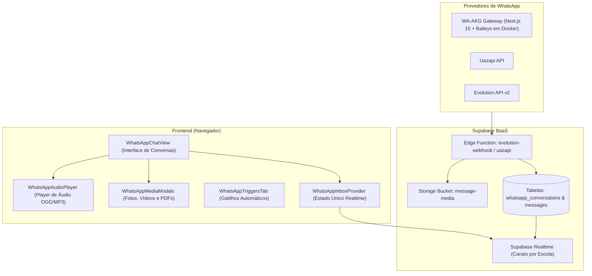

# 💬 06. Comunicação e Integração com WhatsApp

> [!TIP]
> **Manual Especializado à Parte**: Para a documentação técnica exaustiva e detalhada deste subsistema, consulte o [**`MANUAL_COMPLETO_MODULO_WHATSAPP.md`**](./MANUAL_COMPLETO_MODULO_WHATSAPP.md) (abrangendo a especificação da API Baileys, orquestração Docker Compose do WA-AKG, deduplicação no PostgreSQL, decodificação de áudio OGG Opus e motor de chatbots com variáveis).

A Central de Mensagens do **Purple Edu** centraliza os canais de WhatsApp da escola em um ambiente multi-atendente por setores, eliminando a dependência de aparelhos físicos individuais e garantindo segurança jurídica nas conversas com famílias.

---

## 1. Visão Arquitetural da Mensageria

O sistema adota o padrão de **Provedor Centralizado de Estado (`WhatsAppInboxProvider`)**, onde a página mantém estritamente **uma única conexão realtime via WebSocket** e um único cache de dados:

---

## 2. Gateways de WhatsApp Homologados

### 2.1 Gateway WA-AKG (Baileys + Docker)
- **Localização**: Arquivo `docker-compose.wa-akg.yml` e cliente `src/services/waAkgClient.ts`.
- **Tecnologia**: Next.js 15 + biblioteca Baileys oficial rodando em container Docker dedicado acompanhado de banco MySQL para sessões.
- **Vantagens**: Custo zero de licença por mensagem, conexão direta via QR Code e alto throughput de entrega.
- **Porta Padrão**: `3000` (API) e `3307` (MySQL).

### 2.2 Uazapi API
- **Localização**: `src/components/settings/UazapiSettings.tsx` e função `supabase/functions/uazapi`.
- **Regra de Ouro**: A verificação de status da instância é estritamente **somente-leitura** para evitar consumo abusivo de requisições de rede.

### 2.3 Evolution API
- **Localização**: `supabase/functions/evolution-api` e `evolution-webhook`.
- **Recursos**: Suporte a webhooks de entrega, leitura (double check azul) e digitação em tempo real.

---

## 3. Diretrizes de Engenharia e Mídia Permanente

> [!CAUTION]
> Provedores de WhatsApp geram URLs de mídia com tempo de expiração curto (geralmente entre 2 e 24 horas). Renderizar URLs diretas do provedor faz com que fotos e áudios antigos fiquem inacessíveis no histórico da escola.

### 3.1 Normalização e Cópia Automática de Mídia
1. Ao receber um evento de mensagem de mídia (`imageMessage`, `audioMessage`, `documentMessage`, `videoMessage`, `stickerMessage`):
2. O webhook baixa imediatamente os bytes do provedor.
3. Faz o upload definitivo para o bucket do Supabase:
   $$\text{Caminho} = \texttt{message-media/\{school\_id\}/\{conversation\_id\}/\{hash\}\_\{filename\}}$$
4. Grava no banco apenas a URL permanente gerada.

### 3.2 Persistência Única de Mensagens (Deduplicação)
Para evitar duplicação em caso de retransmissão de webhooks pelo gateway:
- O sistema impõe índice único em `(school_id, provider_message_id)`.
- Se o ID já existir, o webhook descarta silenciosamente o payload duplicado.

---

## 4. Renderizadores de Mídia Ricos

- **Áudios de Voz (`WhatsAppAudioPlayer.tsx`)**:
  - Reproduz notas de voz no formato OGG Opus nativo do WhatsApp e MP3.
  - Barra de progresso interativa, controle de velocidade (1x, 1.5x, 2x) e indicação de duração.
- **Imagens e Vídeos (`WhatsAppMediaModals.tsx`)**:
  - Visualização inline no balão com zoom em modal lightbox de alta definição.
- **Documentos e PDFs**:
  - Exibe ícone de documento, tamanho do arquivo e botão de download imediato.
- **Figurinhas (Stickers)**:
  - Renderização transparente sem moldura de fundo.

---

## 5. Gatilhos Inteligentes & Respostas Automáticas (`WhatsAppTriggersTab.tsx`)

O sistema permite criar fluxos automatizados de atendimento:
- **Mensagem de Boas-Vindas**: Disparada automaticamente no primeiro contato de um novo número.
- **Mensagem de Ausência (Fora do Horário Comercial)**: Disparada à noite ou nos fins de semana conforme horário escolar cadastrado.
- **Gatilhos por Palavra-Chave**:
  - Exemplo: Palavra `"mensalidade"` ➔ Responde com o menu de opções financeiras e link da 2ª via.
  - Exemplo: Palavra `"cardápio"` ➔ Envia a relação de refeições da semana da cantina.
- **Edição Dinâmica (`WhatsAppAdjustableTriggerModal.tsx`)**: Permite alterar o texto e o setor de encaminhamento sem reiniciar serviços.

---

## 6. Distribuição por Setores e Permissões de Atendimento

Cada conversa no WhatsApp pertence a um setor institucional:

| Setor | Finalidade | Usuários Autorizados |
| :--- | :--- | :--- |
| **Secretaria** | Matrículas, dúvidas cadastrais, declarações | Usuários com perfil `secretary` e `director` |
| **Financeiro** | Carnês, 2ª via de boletos, cobrança | Usuários com perfil `admin` e `director` |
| **Coordenação Pedagógica** | Desempenho escolar, recados de professores | Coordenadores e `director` |
| **Direção Geral** | Assuntos institucionais reservados | Apenas `director` |

- Um atendente da Secretaria **não consegue ler nem responder conversas do setor Financeiro**, garantindo conformidade com a LGPD e privacidade financeira das famílias.

