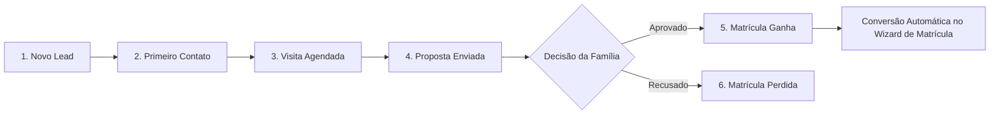

# 📈 07. Comercial e CRM de Captação de Matrículas

O Módulo Comercial do **Purple Edu** profissionaliza o processo de atração, qualificação e conversão de novas famílias, transformando o ciclo de matrículas em um funil previsível e mensurável.

---

## 1. Funil de Vendas de Matrículas (Kanban)

Localizado em `src/pages/Comercial.tsx`, o pipeline de captação é organizado visualmente no formato Kanban:

### 1.1 Estágios do Pipeline
1. **Novo Lead**: Contato inicial capturado através do formulário da Landing Page pública, campanha de anúncios no Instagram ou mensagem no WhatsApp.
2. **Primeiro Contato**: Família atendida pela equipe de vendas; triagem de interesse, série pretendida e turno.
3. **Visita Agendada**: Agendamento de tour presencial pelas dependências da escola, laboratórios e apresentação pedagógica.
4. **Proposta Enviada**: Condições comerciais apresentadas (plano de mensalidade, desconto de irmãos, taxa de material).
5. **Ganha (Convertida)**: Matrícula confirmada e contrato assinado.
6. **Perdida**: Caso a família opte por outra escola, o sistema exige o registro do **Motivo de Perda** (Preço, Localização, Metodologia, Falta de Vaga).

---

## 2. Ficha de Oportunidade e Lead (`useCRMLeads.ts`)

Cada oportunidade de captação registra:
- **Dados do Aluno Pretendido**: Nome da criança, data de nascimento e série desejada.
- **Dados do Responsável**: Nome completo, telefone WhatsApp, e-mail e bairro.
- **Canal de Origem**:
  - `Instagram / Tráfego Pago`
  - `Google / Site da Escola`
  - `Indicação de Aluno Atual`
  - `Fachada / Presencial`
  - `Outro`
- **Linha do Tempo de Interações**: Histórico de notas internas, ligações efetuadas e mensagens trocadas.
- **Agendamento de Retorno (Follow-up)**: Data e hora para a equipe comercial retomar o contato.

---

## 3. Conversão com 1 Clique em Matrícula Efetiva

Ao mover o card para a coluna **"Ganha"** ou clicar no botão **"Matricular"**:
1. O sistema dispara o **Wizard de Matrícula** (`MatriculaWizardModal.tsx`).
2. Os dados de nome do aluno, telefone e filiação já vêm **preenchidos automaticamente**.
3. A secretária apenas confirma os documentos oficiais e aloca a turma.
4. O lead é arquivado como cliente ativo na base de alunos sem digitação duplicada.

---

## 4. Painel do Vendedor (`src/pages/PainelVendedor.tsx`)

Visão customizada para consultores de matrículas e secretárias com metas comerciais:
- **Taxa de Conversão**: Percentual de leads que viraram alunos matriculados no mês.
- **Tempo Médio de Primeiro Contato**: Indicador de agilidade no atendimento de novas mensagens.
- **Metas do Período**: Barra de progresso comparando o número atual de matrículas versus a meta estabelecida pela direção.

