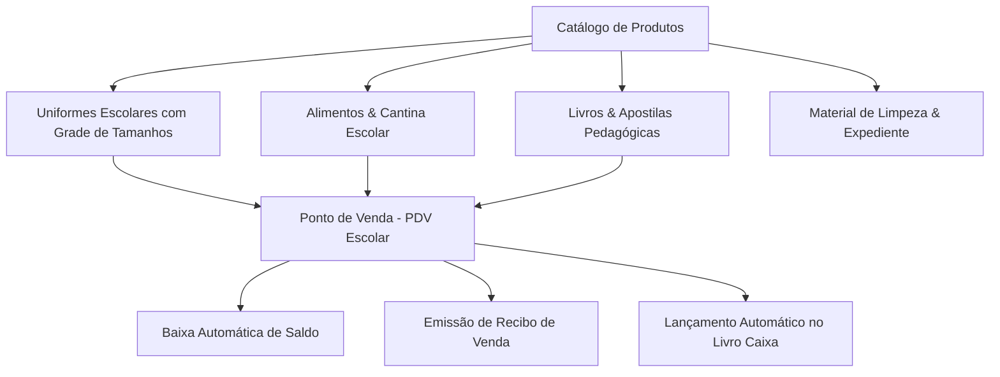

# 📦 08. Estoque, Cantina Escolar e Gestão Administrativa/RH

Este documento detalha o controle de patrimônio, almoxarifado escolar, PDV de cantina/uniformes e o módulo de Recursos Humanos do **Purple Edu**.

---

## 1. Estoque e Almoxarifado Escolar (`src/pages/Estoque.tsx`)

O controle de estoque atende tanto ao consumo interno da instituição quanto à comercialização de itens para os alunos e famílias:

### 1.1 Controle de Uniformes com Grade de Variações
- Cadastro unificado por modelo (ex.: *Camiseta Manga Curta Institucional*, *Bermuda Helanca*, *Agasalho de Inverno*).
- **Grade de Tamanhos Flexível**: Suporta tamanhos infantis (`02`, `04`, `06`, `08`, `10`, `12`, `14`) e adultos (`P`, `M`, `G`, `GG`).
- Estoque mínimo por variação com alertas visuais de reposição.

### 1.2 Ponto de Venda da Cantina (PDV)
- Interface otimizada para atendimento rápido em balcão:
  - Busca instantânea por leitor de código de barras ou digitação.
  - Seleção do aluno para débito em conta pré-paga ou pagamento imediato (Pix, Dinheiro, Cartão de Débito/Crédito).
  - Impressão de **Comprovante de Venda** (`ReciboVendaEstoqueModal.tsx`).

---

## 2. Módulo Administrativo e Recursos Humanos (`src/pages/Administrativo.tsx`)

O módulo Administrativo apoia a diretoria na gestão da equipe docente e funcional:

### 2.1 Cadastro do Corpo Docente e Colaboradores
- Ficha completa do funcionário:
  - Dados pessoais, CPF, PIS/PASEP, CTPS, formação acadêmica e foto.
  - Cargo/Função (Professor Regente, Auxiliar de Sala, Secretária, Coordenador, Zelador, Merendeira).
  - Departamento / Setor vinculado.
  - Salário base e carga horária semanal.

### 2.2 Gestão de Ponto e Frequência
- Registro de assiduidade de colaboradores:
  - Lançamento de faltas justificadas com anexo de atestado médico.
  - Registro de atrasos e substituições de aulas entre professores.
  - Relatório de fechamento mensal para apoio ao cálculo da folha de pagamento na contabilidade externa.

