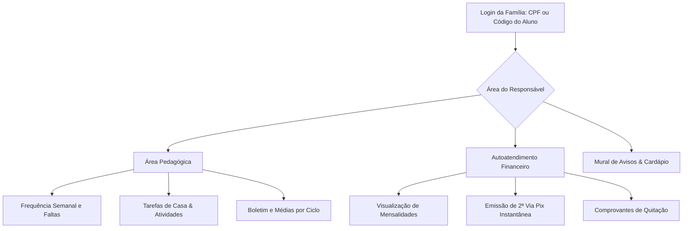
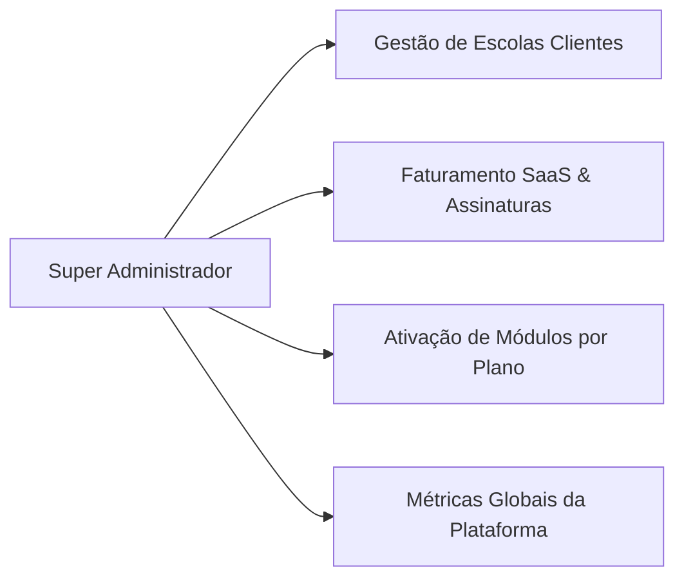

# 🌐 09. Portal da Família e Painel Super Admin (SaaS)

Este documento aborda os dois extremos do ecossistema do **Purple Edu**: a experiência externa das famílias de alunos e a gestão master da plataforma de software como serviço (SaaS).

---

## 1. Portal do Responsável e Aluno (`src/pages/portal/`)

O Portal da Família é um canal web responsivo e leve, desenhado especificamente para visualização em smartphones por pais e alunos.

### 1.1 Autenticação Simplificada
- Acesso sem senhas complexas: autenticação por CPF cadastrado do responsável ou código único da matrícula do estudante gerado na secretaria.
- Proteção de dados: o responsável visualiza exclusivamente os filhos vinculados ao seu CPF.

### 1.2 Acompanhamento Acadêmico
- **Frequência em Tempo Real**: Alertas de faltas no mesmo dia em que o professor registra a chamada.
- **Tarefas de Casa**: Relação de exercícios passados em sala, páginas de livros e prazos de entrega.
- **Boletim Digital**: Visualização clara de notas bimestrais/trimestrais com cores indicativas (azul para acima da média e vermelho para atenção).

### 1.3 Autoatendimento Financeiro
- Elimina filas na secretaria escolar:
  - O pai acessa a lista de parcelas em aberto.
  - Clica em **"Pagar com Pix"** para copiar o código Copia e Cola ou escanear o QR Code.
  - Recebe baixa automática assim que a liquidação é confirmada pelo banco.

---

## 2. Painel Super Admin (Gestão Master SaaS) (`src/pages/SuperAdmin.tsx`)

O Painel Super Admin é a central de comando do operador e mantenedor da plataforma **Purple Edu**, permitindo gerenciar todas as escolas clientes cadastradas:

### 2.1 Gestão Multi-Tenant de Escolas
- Cadastro de novas instituições clientes com geração automática de chaves e tenant `school_id`.
- Configuração de limites contratuais:
  - Limite máximo de alunos ativos por plano (ex.: até 200 alunos, até 600 alunos, ilimitado).
  - Bloqueio ou suspensão temporária por inadimplência com exibição de paywall amigável.

### 2.2 Controle de Assinaturas e Billing (`usePlatformBillingSettings.ts`)
- Planos de assinatura do SaaS:
  - `Plano Start`: Pedagógico + Secretaria + Diário.
  - `Plano Pro`: Pedagógico + Secretaria + Financeiro + Boletos/Pix.
  - `Plano Enterprise`: Acesso total com WhatsApp multi-atendimento, CRM e multi-sedes.
- Emissão de faturas recorrentes de mensalidade do software cobradas da instituição.

### 2.3 Métricas Globais da Plataforma
- Total de escolas ativas no ecossistema.
- Censo total de alunos matriculados transacionando na plataforma.
- Volume financeiro total transacionado pelas escolas no mês.
- Monitoramento de saúde dos servidores e conexões de WhatsApp.

