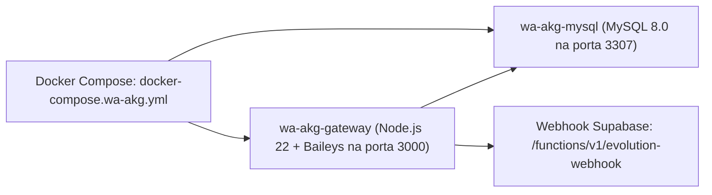

# 🚀 10. Guia de Instalação, Deploy e Operações (DevOps)

Este documento fornece instruções completas para execução do ambiente de desenvolvimento, orquestração de containers com Docker Compose e deploy em produção do **Purple Edu**.

---

## 1. Pré-Requisitos do Sistema

Para rodar todo o ecossistema localmente ou em servidor VPS/Cloud:
- **Node.js**: Versão `18.x`, `20.x` ou `22.x` (LTS recomendada).
- **Gerenciador de Pacotes**: `npm` v9+ ou `pnpm` / `yarn`.
- **Docker & Docker Compose**: v24+ (para o gateway WA-AKG e MySQL).
- **Git**: Para versionamento e controle de branches.
- **Conta Supabase**: Projeto ativo com PostgreSQL 15+.

---

## 2. Variáveis de Ambiente (`.env`)

Crie um arquivo `.env` na raiz do projeto com as chaves correspondentes:

```env
# Conexão Supabase Frontend
VITE_SUPABASE_URL=https://eafntyicpalnyzonnrgn.supabase.co
VITE_SUPABASE_ANON_KEY=eyJhbGciOi...sua-chave-anonima...

# Configuração de Porta de Desenvolvimento (Opcional)
PORT=8080

# Integração Gateway WhatsApp WA-AKG (Local ou VPS)
VITE_WA_AKG_BASE_URL=http://localhost:3000
VITE_WA_AKG_API_KEY=sua-chave-secreta-jwt-32-caracteres-minimo

# Provedor Bancário Padrão (Cora / Asaas)
VITE_DEFAULT_BANK_GATEWAY=cora
```

---

## 3. Instalação e Execução do Frontend React

```bash
# 1. Clonar o repositório do projeto
git clone https://github.com/neto-prax/escolinha.git
cd escolinha

# 2. Instalar todas as dependências
npm install

# 3. Executar o servidor de desenvolvimento Vite (HMR ativo)
npm run dev

# O sistema estará acessível em: http://localhost:8080 ou http://localhost:5173
```

### Validação de Tipos e Qualidade de Código
Antes de realizar commits ou deploys, execute a checagem rigorosa do TypeScript:

```bash
# Verificação estática sem emitir arquivos (deve retornar 0 erros)
node ./node_modules/.bin/tsc --noEmit

# Compilação completa para produção com empacotamento otimizado
node ./node_modules/.bin/vite build
```

---

## 4. Deploy do Gateway WA-AKG (Docker Compose)

O gateway do WhatsApp utiliza o arquivo `docker-compose.wa-akg.yml`, composto por dois containers interconectados em rede interna:



### Comandos de Inicialização do Gateway
```bash
# Subir os containers em segundo plano (daemon)
docker compose -f docker-compose.wa-akg.yml up -d

# Visualizar logs em tempo real do gateway e conexão WhatsApp
docker compose -f docker-compose.wa-akg.yml logs -f wa-akg

# Parar os serviços preservando os volumes de sessão
docker compose -f docker-compose.wa-akg.yml down
```

> [!NOTE]
> As credenciais de sessão do WhatsApp e o QR Code ficam preservados nos volumes Docker `wa-akg-sessions` e `wa-akg-data`, impedindo desconexões durante reinicializações do servidor.

---

## 5. Configuração e Migrações do Supabase

### 5.1 Supabase CLI e Vinculação de Projeto
```bash
# Login na CLI do Supabase
npx supabase login

# Vincular ao projeto remoto
npx supabase link --project-ref eafntyicpalnyzonnrgn
```

### 5.2 Aplicação de Migrações SQL
O diretório `supabase/migrations/` contém todas as migrações incrementais do banco:
```bash
# Aplicar todas as migrações pendentes no banco de dados remoto
npx supabase db push
```

### 5.3 Deploy das Edge Functions
Para publicar alterações nas funções serverless do Deno:
```bash
# Deploy de todas as 12 edge functions
npx supabase functions deploy create-user
npx supabase functions deploy create-guardian-access
npx supabase functions deploy update-user-email
npx supabase functions deploy update-user-password
npx supabase functions deploy signup-with-school
npx supabase functions deploy super-admin
npx supabase functions deploy daily-financial-report
npx supabase functions deploy evolution-api
npx supabase functions deploy evolution-webhook
npx supabase functions deploy uazapi
npx supabase functions deploy wa-akg
npx supabase functions deploy google-drive
```

---

## 6. Build de Produção e Hospedagem Web

Para hospedar o frontend em servidores estáticos (Vercel, Netlify, Cloudflare Pages ou Nginx):

```bash
# Gera o diretório otimizado /dist
npm run build

# Testar localmente a versão compilada em porta de produção
npm run preview
```

### Configuração de Redirecionamento SPA (Nginx / Vercel)
Como o sistema utiliza `BrowserRouter` do React Router, qualquer requisição para sub-rotas (`/app/alunos`, `/app/financeiro`, etc.) deve ser redirecionada para `index.html`:

```nginx
# Exemplo para bloco de configuração Nginx
location / {
    root /var/www/escolinha/dist;
    index index.html;
    try_files $uri $uri/ /index.html;
}
```

---

## 7. Diagnóstico e Resolução de Problemas Comuns (Troubleshooting)

| Sintoma | Causa Mais Frequente | Resolução Recomendada |
| :--- | :--- | :--- |
| **Erro 401 / 403 no Supabase** | Chave `anon` expirada ou RLS bloqueando acesso do usuário. | Verificar se o usuário autenticado possui registro ativo na tabela `profiles` com `school_id` correspondente. |
| **QR Code do WhatsApp não aparece** | Container WA-AKG sem comunicação com o MySQL interno. | Verificar saúde do banco com `docker exec -it wa-akg-db mysqladmin ping -proot_pass_wa_akg`. |
| **Áudios do WhatsApp sem tocar no chat** | Áudio em formato OGG Opus sem codecs compatíveis no navegador. | O componente `WhatsAppAudioPlayer.tsx` utiliza decodificação com Web Audio API para reproduzir arquivos de voz. |
| **Dados vazando entre escolas no mesmo navegador** | Chave de localStorage antiga sem prefixo `s_{schoolId}_`. | Fazer logout no sistema; o hook `useLocalStorage` limpa automaticamente estados órfãos e recarrega os dados com escopo restrito da escola atual. |
| **Erro de build por chunks grandes** | Dependências ricas como jsPDF, html2canvas ou XLSX. | Configuração normal em ERPs ricos; o Vite gera minificação gzip adequada que garante carregamento veloz em produção. |

