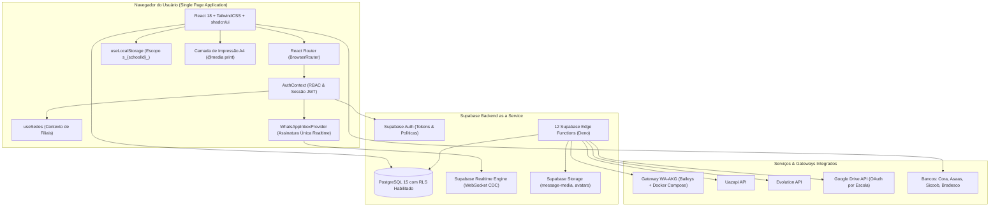
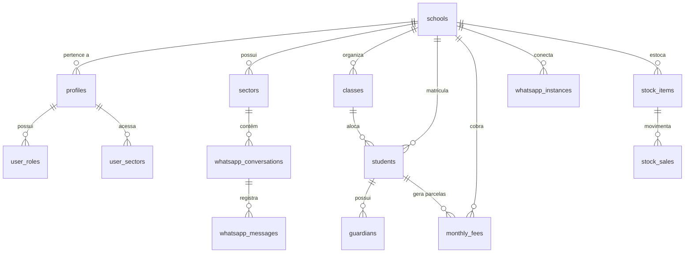

# 🎓 Purple Edu — Sistema de Gestão Escolar Completa (ERP SaaS)
## Manual Técnico e Operacional Unificado da Plataforma

> [!NOTE]
> Este documento constitui a documentação integral e exaustiva do projeto **Purple Edu** (também denominado *Colégio Interagir ERP* ou *Connect School Hub*). Ele unifica todas as especificações de negócio, arquitetura de software, modelagem de banco de dados, regras de segurança, fluxos operacionais e manuais de deploy em um único volume.

---

## 📑 Sumário Geral

1. [Visão Geral do Projeto e Objetivos](#1-visão-geral-do-projeto-e-objetivos)
2. [Stack Tecnológica Completa](#2-stack-tecnológica-completa)
3. [Arquitetura de Software e Decisões de Engenharia](#3-arquitetura-de-software-e-decisões-de-engenharia)
   - 3.1 [Diagrama de Arquitetura Global](#31-diagrama-de-arquitetura-global)
   - 3.2 [Princípios de Isolamento e Multi-Tenancy](#32-princípios-de-isolamento-e-multi-tenancy)
   - 3.3 [Diretrizes Mandatórias de Arquitetura (AGENTS.md)](#33-diretrizes-mandatórias-de-arquitetura-agentsmd)
   - 3.4 [Armazenamento Híbrido e Cache Local com Escopo](#34-armazenamento-híbrido-e-cache-local-com-escopo)
4. [Controle de Acesso Baseado em Perfis (RBAC)](#4-controle-de-acesso-baseado-em-perfis-rbac)
   - 4.1 [Definição dos Papéis (`AppRole`)](#41-definição-dos-papéis-approle)
   - 4.2 [Matriz de Permissões por Módulo](#42-matriz-de-permissões-por-módulo)
5. [Arquitetura Multi-Sedes e Gestão de Filiais](#5-arquitetura-multi-sedes-e-gestão-de-filiais)
   - 5.1 [Sede Matriz e Filiais](#51-sede-matriz-e-filiais)
   - 5.2 [Ferramentas de Manutenção: Zerar Unidade e Ações em Lote](#52-ferramentas-de-manutenção-zerar-unidade-e-ações-em-lote)
6. [Banco de Dados, RLS e Serviços Serverless (Supabase)](#6-banco-de-dados-rls-e-serviços-serverless-supabase)
   - 6.1 [Diagrama Entidade-Relacionamento (ERD)](#61-diagrama-entidade-relacionamento-erd)
   - 6.2 [Catálogo de Tabelas do Domínio](#62-catálogo-de-tabelas-do-domínio)
   - 6.3 [Políticas de Segurança a Nível de Linha (RLS)](#63-políticas-de-segurança-a-nível-de-linha-rls)
   - 6.4 [Catálogo das 12 Edge Functions](#64-catálogo-das-12-edge-functions)
   - 6.5 [Buckets de Armazenamento (Supabase Storage)](#65-buckets-de-armazenamento-supabase-storage)
7. [Módulo Pedagógico e Gestão Acadêmica](#7-módulo-pedagógico-e-gestão-acadêmica)
   - 7.1 [Diário de Classe e Frequência Verídica](#71-diário-de-classe-e-frequência-verídica)
   - 7.2 [Planejamento de Aulas BNCC e Detecção de Atrasos](#72-planejamento-de-aulas-bncc-e-detecção-de-atrasos)
   - 7.3 [Avaliações, Notas e Ciclos de Médias](#73-avaliações-notas-e-ciclos-de-médias)
   - 7.4 [Turmas, Séries e Grade Horária](#74-turmas-séries-e-grade-horária)
   - 7.5 [Calendário Escolar Oficial 2026 e Impressão Anual A4](#75-calendário-escolar-oficial-2026-e-impressão-anual-a4)
8. [Módulo Financeiro e Automação de Cobrança](#8-módulo-financeiro-e-automação-de-cobrança)
   - 8.1 [Gestão de Mensalidades, Carnês e Inadimplência](#81-gestão-de-mensalidades-carnês-e-inadimplência)
   - 8.2 [Régua Automatizada de Cobrança via WhatsApp](#82-régua-automatizada-de-cobrança-via-whatsapp)
   - 8.3 [Geração de Meios de Pagamento: Pix EMV e Boletos](#83-geração-de-meios-de-pagamento-pix-emv-e-boletos)
   - 8.4 [Caixas, Lançamentos e DRE Escolar](#84-caixas-lançamentos-e-dre-escolar)
9. [Secretaria Escolar e Gestão de Alunos](#9-secretaria-escolar-e-gestão-de-alunos)
   - 9.1 [Cadastro 360º do Aluno e Responsáveis](#91-cadastro-360º-do-aluno-e-responsáveis)
   - 9.2 [Wizard de Matrícula Guiado](#92-wizard-de-matrícula-guiado)
   - 9.3 [Transferência de Turma em Massa](#93-transferência-de-turma-em-massa)
   - 9.4 [Emissão de Documentação Escolar Dinâmica](#94-emissão-de-documentação-escolar-dinâmica)
10. [Central de Mensagens e Integração WhatsApp](#10-central-de-mensagens-e-integração-whatsapp)
    - 10.1 [Provedor Centralizado de Inbox (`WhatsAppInboxProvider`)](#101-provedor-centralizado-de-inbox-whatsappinboxprovider)
    - 10.2 [Gateways Homologados: WA-AKG, Uazapi e Evolution](#102-gateways-homologados-wa-akg-uazapi-e-evolution)
    - 10.3 [Normalização e Armazenamento Permanente de Mídias](#103-normalização-e-armazenamento-permanente-de-mídias)
    - 10.4 [Gatilhos Inteligentes e Distribuição por Setores](#104-gatilhos-inteligentes-e-distribuição-por-setores)
11. [Comercial e CRM de Matrículas](#11-comercial-e-crm-de-matrículas)
    - 11.1 [Pipeline Kanban de Captação](#111-pipeline-kanban-de-captação)
    - 11.2 [Conversão de Lead em Aluno com 1 Clique](#112-conversão-de-lead-em-aluno-com-1-clique)
    - 11.3 [Painel do Vendedor e Metas Comerciais](#113-painel-do-vendedor-e-metas-comerciais)
12. [Estoque, Cantina Escolar e Gestão de RH](#12-estoque-cantina-escolar-e-gestão-de-rh)
    - 12.1 [Grade de Uniformes e Almoxarifado](#121-grade-de-uniformes-e-almoxarifado)
    - 12.2 [Ponto de Venda (PDV) da Cantina](#122-ponto-de-venda-pdv-da-cantina)
    - 12.3 [Quadro de Funcionários e Folha de Ponto](#123-quadro-de-funcionários-e-folha-de-ponto)
13. [Portais Externos e Painel Super Admin (SaaS)](#13-portais-externos-e-painel-super-admin-saas)
    - 13.1 [Portal do Responsável e Aluno](#131-portal-do-responsável-e-aluno)
    - 13.2 [Painel Super Admin e Faturamento Multi-Escola](#132-painel-super-admin-e-faturamento-multi-escola)
14. [Guia de Instalação, Deploy com Docker e Operações](#14-guia-de-instalação-deploy-com-docker-e-operações)
    - 14.1 [Configuração de Ambiente e Execução Local](#141-configuração-de-ambiente-e-execução-local)
    - 14.2 [Deploy do Gateway WA-AKG via Docker Compose](#142-deploy-do-gateway-wa-akg-via-docker-compose)
    - 14.3 [Migrações e Edge Functions no Supabase](#143-migrações-e-edge-functions-no-supabase)
    - 14.4 [Build de Produção e Otimizações](#144-build-de-produção-e-otimizações)
15. [Glossário e Padrões de Qualidade de Código](#15-glossário-e-padrões-de-qualidade-de-código)
16. [Qualidade de Software: Testes Unitários e Pre-Commit Hook](#16-qualidade-de-software-testes-unitários-e-pre-commit-hook)
    - 16.1 [Arquitetura de Testes com Node 22 e TSX](#161-arquitetura-de-testes-com-node-22-e-tsx)
    - 16.2 [Garantia de Qualidade Pré-Commit (.git/hooks/pre-commit)](#162-garantia-de-qualidade-pré-commit-githookspre-commit)
    - 16.3 [Manual Detalhado de Testes e Erros Prevenidos](#163-manual-detalhado-de-testes-e-erros-prevenidos)

---

## 1. Visão Geral do Projeto e Objetivos

O **Purple Edu** é um software como serviço (SaaS) de gestão escolar de ponta a ponta projetado para escolas privadas de Educação Infantil, Ensino Fundamental (Anos Iniciais e Finais) e Ensino Médio.

### 1.1 Desafios Resolvidos pelo Sistema
- **Fragmentação Operacional**: Substitui planilhas desconexas, fichários físicos de secretaria e múltiplos sistemas legados por uma interface única, rápida e padronizada.
- **Rigor Acadêmico**: Elimina erros de lançamento de frequência através de validação cruzada com o calendário escolar, além de sinalizar visualmente atrasos em planejamentos pedagógicos alinhados à BNCC.
- **Inadimplência Reduzida**: Automação ativa da régua de cobrança multicanal (WhatsApp e e-mail) antes e após o vencimento, permitindo pagamento em segundos via Pix dinâmico ou boleto registrado.
- **Atendimento Humanizado e Seguro via WhatsApp**: Centraliza o número da instituição em múltiplos setores (Secretaria, Financeiro, Coordenação) sem expor números pessoais de colaboradores e protegendo dados financeiros sensíveis.
- **Multi-Unidade Real**: Permite redes de ensino gerenciarem matriz e filiais no mesmo painel com segregação de alunos, turmas e caixas.

---

## 2. Stack Tecnológica Completa

| Camada | Tecnologia | Detalhes da Versão e Papel no Sistema |
| :--- | :--- | :--- |
| **Linguagem Principal** | [[TypeScript]] 5.8 | Tipagem estática rigorosa, contratos de interfaces e segurança de compilação. |
| **Framework Web** | [[React]] 18.3.1 | Renderização reativa em componentes funcionais e hooks customizados. |
| **Ferramenta de Build** | [[Vite]] 5.4.19 | Bundler de altíssima velocidade com suporte a Hot Module Replacement (HMR). |
| **Roteamento** | [[React Router]] v6 | Navegação declarativa com middlewares de proteção de rota por perfil. |
| **Estilização & CSS** | [[TailwindCSS]] 3.4.17 | Classes utilitárias, temas institucionais e regras estritas de `@media print`. |
| **Design System** | [[shadcn/ui]] + [[Radix UI]] | Primitivos acessíveis WAI-ARIA (Dialog, DropdownMenu, Tabs, Select, Switch). |
| **Biblioteca de Ícones** | [[Lucide React]] | Conjunto visual moderno e consistente com centenas de glifos vetoriais. |
| **Visualização de Dados** | [[Recharts]] 2.15 | Gráficos responsivos de fluxo financeiro, inadimplência e evolução pedagógica. |
| **Tratamento de Datas** | [[date-fns]] 3.6 | Operações de calendário, intervalos letivos e formatação em português `pt-BR`. |
| **Gerenciamento de Cache**| [[TanStack Query]] v5 | Revalidação em segundo plano e sincronização assíncrona de estado remoto. |
| **Backend & BaaS** | [[Supabase]] PostgreSQL 15 | Banco relacional, autenticação JWT, Row Level Security e Realtime WebSocket. |
| **Funções Serverless** | Supabase Edge Functions | Deno Runtime para integrações bancárias, webhooks e rotinas administrativas. |
| **Gateway WhatsApp** | [[WA-AKG]] + [[Baileys]] | Container Docker dedicado com Next.js 15 e MySQL 8.0 para conexão via QR Code. |
| **Exportação de Relatórios**| [[jsPDF]] + [[xlsx]] | Geração client-side de contratos, recibos em PDF e planilhas contábeis em Excel. |

---

## 3. Arquitetura de Software e Decisões de Engenharia

### 3.1 Diagrama de Arquitetura Global



### 3.2 Princípios de Isolamento e Multi-Tenancy
1. **Identificador Global da Instituição (`school_id`)**:
   - Cada requisição e registro relacional é atrelado ao identificador da escola.
   - Políticas de Row Level Security barram tentativas de leitura entre escolas distintas.
2. **Separação de Contexto no Armazenamento Local**:
   - O hook `useLocalStorage` prefixa todas as chaves no formato `s_${schoolId}_${key}`.
   - Impede que ao efetuar logout de uma escola e login em outra, os dados em cache no navegador vazem entre contas.

### 3.3 Diretrizes Mandatórias de Arquitetura (AGENTS.md)
- **Centralização do WhatsApp**: Todo o estado da inbox reside no `WhatsAppInboxProvider`. Uma página aberta mantém apenas **uma assinatura realtime** e um conjunto de queries.
- **Verificação Somente-Leitura**: As consultas de status de instâncias da Uazapi são estritamente de leitura, impedindo rajadas de chamadas de configuração desnecessárias.
- **Persistência Única de Mensagens**: Cada ID de mensagem do provedor (`message_id`) é registrado exatamente uma vez no banco, eliminando duplicações em retransmissões.
- **Normalização de Mídias Recebidas**: URLs fornecidas por gateways de WhatsApp são temporárias; o webhook obrigatoriamente baixa e copia o arquivo para o bucket permanente `message-media` sob `escola/conversa/{media_id}` antes de exibi-lo no frontend.
- **Mídias Pedagógicas no Google Drive**: Documentos e planos pesados de cada escola são salvos exclusivamente no Google Drive da própria instituição via upload resumável no navegador; as credenciais de OAuth ficam seguras na Edge Function.
- **Consentimento Google em Callback Same-Origin**: A autorização do Google Drive ocorre em callback público na mesma origem com `state` de uso único, mantendo o processo resiliente e seguro contra ataques de replay.

### 3.4 Armazenamento Híbrido e Cache Local com Escopo
- O sistema opera no modelo **Offline-First / Cache Otimizado**:
  - Dados de turmas, alunos, sedes e eventos são mantidos no navegador para renderização em menos de 50ms.
  - Sincronização em nuvem (`src/lib/cloudState.ts`) salva snapshots de estado no PostgreSQL do Supabase, permitindo que alterações efetuadas em um computador sejam restauradas em outros dispositivos da mesma instituição.

---

## 4. Controle de Acesso Baseado em Perfis (RBAC)

### 4.1 Definição dos Papéis (`AppRole`)

```typescript
// src/types/auth.ts
export type AppRole = 'teacher' | 'secretary' | 'admin' | 'director' | 'seller';
```

- **`director`**: Acesso completo e irrestrito. Administra finanças, contratos, alunos, professores, configurações e WhatsApp.
- **`teacher`**: Foco exclusivo em atividades docentes. Visualiza apenas suas turmas, preenche o diário de classe, registra faltas e lança notas.
- **`secretary`**: Gerencia cadastros de alunos, matrículas, emissão de documentos, funil comercial e mensagens do setor de secretaria.
- **`admin`**: Foco financeiro e patrimonial. Administra contas a pagar/receber, caixas, colaboradores e compras de estoque.
- **`seller`**: Acesso concentrado no CRM comercial, funil de leads e agendamento de visitas de novas famílias.
- **`superadmin`**: Acesso master transversal à infraestrutura do SaaS para cobrança de licenças e criação de novas escolas.

### 4.2 Matriz de Permissões por Módulo

| Módulo do Sistema | `teacher` | `secretary` | `admin` | `director` | `seller` |
| :--- | :---: | :---: | :---: | :---: | :---: |
| **Dashboard Geral** | ❌ (Vê visão do professor) | 👁️ (Visão da secretaria) | ✅ | ✅ (Visão completa) | ❌ |
| **Pedagógico & Diário**| ✅ (Suas turmas) | 👁️ (Leitura) | ❌ | ✅ | ❌ |
| **Turmas & Séries** | 👁️ (Suas turmas) | ✅ | ❌ | ✅ | ❌ |
| **Alunos & Matrículas**| ❌ | ✅ | 👁️ (Consulta) | ✅ | ❌ |
| **Documentos Escolares**| ❌ | ✅ | ❌ | ✅ | ❌ |
| **Financeiro & Carnês**| ❌ | ❌ | ✅ | ✅ | ❌ |
| **Livro Caixa & DRE** | ❌ | ❌ | ✅ | ✅ | ❌ |
| **Central WhatsApp** | ⚠️ (Diário apenas) | ✅ (Setor Secretaria) | ✅ (Setor Financeiro) | ✅ (Todos os setores) | ⚠️ (Setor Comercial) |
| **Comercial / CRM** | ❌ | ✅ | ✅ | ✅ | ✅ |
| **Estoque & Cantina** | ❌ | ✅ | ✅ | ✅ | ❌ |
| **Administrativo / RH**| ❌ | 👁️ (Leitura) | ✅ | ✅ | ❌ |
| **Configurações Gerais**| ❌ | ❌ | ⚠️ (Parcial) | ✅ | ❌ |

---

## 5. Arquitetura Multi-Sedes e Gestão de Filiais

Para atender redes escolares que possuem Unidade Matriz e Unidades Filiais, o sistema provê o motor `useSedes.ts`:

### 5.1 Sede Matriz e Filiais
- Toda instituição possui uma sede padrão (`sede-matriz`, ex.: "Sede Principal Papagaio").
- Filiais adicionais recebem identificadores únicos (ex.: `sede-senador-01`).
- Na barra de navegação superior (Topbar), o seletor de unidade ativa permite alternar o contexto de trabalho instantaneamente.
- O predicado `isItemInActiveSede(itemSedeId, itemUnidadeNome)` assegura que alunos ou lançamentos da filial B nunca apareçam quando a filial A estiver selecionada.

### 5.2 Ferramentas de Manutenção: Zerar Unidade e Ações em Lote
- **Isolamento de Sedes Recém-Criadas**: Ao cadastrar uma nova sede que ainda não migrou dados reais, a visualização inicia estritamente vazia (0 alunos).
- **Recurso "Zerar Unidade" (`src/pages/Alunos.tsx`)**:
  - Disponível exclusivamente para Diretores e Super Admins.
  - Remove todos os alunos e mensalidades acidentalmente atribuídos à sede selecionada com diálogo de segurança duplo (`AlertDialog`), sem tocar nos dados da sede matriz.
- **Exclusão de Selecionados**: Permite selecionar múltiplos estudantes com caixas de marcação para exclusão simultânea de cadastros e títulos financeiros vinculados.

---

## 6. Banco de Dados, RLS e Serviços Serverless (Supabase)

### 6.1 Diagrama Entidade-Relacionamento (ERD)



### 6.2 Catálogo de Tabelas do Domínio
- **`schools`**: ID, nome fantasia, razão social, CNPJ, plano contratado e status da assinatura SaaS.
- **`profiles`**: Vínculo do usuário com o `school_id`, nome completo, foto de avatar e telefone.
- **`user_roles`**: Papéis associados ao usuário (`teacher`, `secretary`, `admin`, `director`, `seller`).
- **`students`**: Nome, matrícula, certidão de nascimento, CPF, turma, turno, restrições médicas e `sede_id`.
- **`guardians`**: Filiação, telefones WhatsApp, CPFs e indicação de responsabilidade financeira/didática.
- **`classes`**: Séries, turmas (`A`, `B`, `C`), turno, ano letivo e professor regente.
- **`monthly_fees`**: Parcelas de anuidade, vencimento, valor base, desconto, acréscimo de contraturno, status, código Pix e linha digitável.
- **`financial_transactions`**: Entradas e saídas contábeis, centro de custos, categoria e caixa vinculado.
- **`whatsapp_instances`**: Instâncias de conexão com gateways WhatsApp (WA-AKG, Uazapi, Evolution).
- **`whatsapp_conversations`**: Contatos e setores de atendimento da central de mensagens.
- **`whatsapp_messages`**: Registro histórico de mensagens, tipo (texto, áudio, imagem), direção e URLs de mídia.
- **`stock_items`**: Produtos, uniformes com grade de tamanhos e alimentos de cantina.
- **`crm_leads`**: Oportunidades de captação de novos alunos no funil comercial.

### 6.3 Políticas de Segurança a Nível de Linha (RLS)
Todas as tabelas do schema público utilizam políticas que impedem leitura e escrita transversal entre escolas. O critério básico consiste em:
```sql
ALTER TABLE public.monthly_fees ENABLE ROW LEVEL SECURITY;

CREATE POLICY "Isolamento por Escola em Mensalidades"
ON public.monthly_fees
FOR ALL
USING (
  school_id IN (SELECT school_id FROM public.profiles WHERE id = auth.uid())
);
```

### 6.4 Catálogo das 12 Edge Functions
1. **`create-user`**: Provisionamento atômico de novo usuário, perfil e permissões.
2. **`create-guardian-access`**: Geração de credencial de primeiro acesso ao Portal da Família.
3. **`update-user-email`**: Atualização segura de e-mail cadastral de colaborador.
4. **`update-user-password`**: Redefinição de senha com autorização administrativa.
5. **`signup-with-school`**: Onboarding com criação de tenant escolar e diretora inicial.
6. **`super-admin`**: Gestão administrativa master de escolas e limites de faturamento.
7. **`daily-financial-report`**: Cron job de resumo financeiro diário por e-mail/notificação.
8. **`evolution-api`**: Disparo de mensagens e comandos via Evolution API.
9. **`evolution-webhook`**: Receptor e normalizador de eventos da Evolution API.
10. **`uazapi`**: Gerenciador de conexão e envios da Uazapi API.
11. **`wa-akg`**: Roteador do gateway WA-AKG Baileys rodando em container Docker.
12. **`google-drive`**: Handshake OAuth 2.0 por escola e uploads resumáveis.

### 6.5 Buckets de Armazenamento (Supabase Storage)
- **`message-media`**: Armazenamento perpétuo de fotos, áudios e anexos recebidos ou enviados via WhatsApp.
- **`avatars`**: Fotos de perfil de professores, funcionários e estudantes.

---

## 7. Módulo Pedagógico e Gestão Acadêmica

### 7.1 Diário de Classe e Frequência Verídica
- **Chamada Inteligente**: Apontamento de Presença (`P`), Falta Simples (`F`) e Falta Justificada (`FJ`).
- **Validação de Feriados**: Bloqueia chamadas em datas marcadas como sem aula no Calendário Escolar.
- **Disparo em Massa**: Envia mensagem com o conteúdo do dia e tarefas aos responsáveis daquela turma.

### 7.2 Planejamento de Aulas BNCC e Detecção de Atrasos
- Registro de conteúdos estruturados com códigos oficiais da BNCC.
- **Alerta Visual de Atraso**: Quando um plano semanal não é concluído dentro do prazo estipulado, o dia no **Calendário do Dashboard da Diretoria** é demarcado com uma **borda vermelha viva** e badge de aviso.

### 7.3 Avaliações, Notas e Ciclos de Médias
- Suporte a Bimestres, Trimestres e Semestres.
- Fórmulas de cálculo selecionáveis:
  - Média Aritmética: $\frac{\sum N_i}{k}$
  - Média Ponderada: $\frac{\sum (N_i \cdot P_i)}{\sum P_i}$
  - Somatória Simples de Pontos.
- Geração com 1 clique do **Boletim Escolar Oficial**.

### 7.4 Turmas, Séries e Grade Horária
- Cadastro por setor pedagógico: Educação Infantil, Fundamental 1, Fundamental 2 e Ensino Médio.
- Grade horária com divisão de slots por matéria e docente regente.

### 7.5 Calendário Escolar Oficial 2026 e Impressão Anual A4
- **Restauração de Feriados 2026**: Injeta instantaneamente todos os feriados nacionais civis e religiosos de 2026.
- **Seletor de Público-Alvo Inteligente**: Toda a Escola, Alunos em Geral, Turmas Específicas, Docentes ou Pais.
- **Impressão Anual Oficial (A4)**:
  - Renderiza todos os 12 meses em grade de 4 colunas harmônicas.
  - Legenda cromática estrita: 🔴 Feriados/Recessos, 🟠 Paradas Pedagógicas, 🟢 Sábados Letivos, 🟣 Eventos, 🔵 Reuniões, 🔷 Provas.
  - Tabela cronológica completa e campos para carimbo/assinatura da Direção e Coordenação.

---

## 8. Módulo Financeiro e Automação de Cobrança

### 8.1 Gestão de Mensalidades, Carnês e Inadimplência
- Cálculo: $\text{Parcela} = (\text{Valor Base} + \text{Contraturno}) - \text{Bolsa}$.
- Parcelamento anual em 11 ou 12 parcelas.
- Baixa manual detalhada por forma de pagamento e caixa de destino.
- Exclusão unitária ou em lote com confirmação.

### 8.2 Régua Automatizada de Cobrança via WhatsApp
- **Lembrete Preventivo (D-5)**: Notificação cordial com chave Pix antecipada.
- **Dia do Vencimento (D-0)**: Aviso de vencimento com link da fatura digital.
- **Inadimplência (D+3 em diante)**: Cobrança com cálculo atualizado e link da 2ª via.

### 8.3 Geração de Meios de Pagamento: Pix EMV e Boletos
- **Pix Dinâmico EMVCo**: Gerador embutido no padrão do Banco Central com QR Code e Copia e Cola.
- **Emissores Bancários**:
  - Banco Cora (API corporativa).
  - Asaas (boletos e cartões).
  - Sicoob (cooperativas de crédito).
  - Banco Bradesco Net Empresa.

### 8.4 Caixas, Lançamentos e DRE Escolar
- Controle de caixas físicos (Secretaria, Cantina) e contas correntes.
- Classificação em custos fixos e variáveis.
- Demonstrativo do Resultado do Exercício (DRE) em tempo real.

---

## 9. Secretaria Escolar e Gestão de Alunos

### 9.1 Cadastro 360º do Aluno e Responsáveis
- Prontuário pessoal, certidão de nascimento, RG, CPF e foto.
- Prontuário médico: Cartão SUS, alergias alimentares, medicamentos autorizados e contatos de emergência.
- Vinculação de Responsáveis Financeiros e Responsáveis Didáticos.

### 9.2 Wizard de Matrícula Guiado (`MatriculaWizardModal.tsx`)
- Processo guiado em 5 etapas: Aluno ➔ Responsáveis ➔ Alocação Acadêmica ➔ Condições Financeiras ➔ Impressão do Contrato.

### 9.3 Transferência de Turma em Massa (`TransferirTurmaModal.tsx`)
- Migração de dezenas de estudantes simultaneamente entre séries ou turmas para o novo ano letivo.

### 9.4 Emissão de Documentação Escolar Dinâmica
- Modelos com tags dinâmicas (`{{aluno_nome}}`, `{{responsavel_nome}}`, `{{valor_mensalidade}}`, `{{turma}}`).
- Contrato de Prestação de Serviços Educacionais com quebras de página.
- Declarações de Matrícula e Frequência.
- Recibos de Matrícula numerados com protocolo único.

---

## 10. Central de Mensagens e Integração WhatsApp

> [!TIP]
> **Manual Técnico Completo e Dedicado**: Para uma especificação exaustiva da API de mensageria, endpoints do container WA-AKG Baileys, configuração de webhooks e motor de chatbots, consulte o [**`MANUAL_COMPLETO_MODULO_WHATSAPP.md`**](./MANUAL_COMPLETO_MODULO_WHATSAPP.md).

### 10.1 Provedor Centralizado de Inbox (`WhatsAppInboxProvider`)
- Centraliza o fluxo de mensagens em uma única conexão WebSocket por janela aberta.

### 10.2 Gateways Homologados: WA-AKG, Uazapi e Evolution
- **WA-AKG Gateway**: Next.js 15 + Baileys rodando via Docker Compose com MySQL.
- **Uazapi**: Integração direta com checagem de status somente-leitura.
- **Evolution API**: Webhooks completos de entrega e leitura.

### 10.3 Normalização e Armazenamento Permanente de Mídias
- Toda mídia recebida é imediatamente copiada para o bucket permanente `message-media` no Supabase Storage.
- Player nativo de áudio para mensagens de voz OGG Opus / MP3.
- Lightbox para fotos e leitor embutido para PDFs.

### 10.4 Gatilhos Inteligentes e Distribuição por Setores
- Respostas automáticas configuráveis por palavra-chave e horário de atendimento.
- Separação de conversas por setor (Secretaria, Financeiro, Coordenação, Direção) com controle estrito de quem pode ler e responder.

---

## 11. Comercial e CRM de Matrículas

### 11.1 Pipeline Kanban de Captação
- Colunas visuais: `Novo Lead` ➔ `Primeiro Contato` ➔ `Visita Agendada` ➔ `Proposta Enviada` ➔ `Ganha` ou `Perdida`.
- Registro de canais de aquisição (Instagram, Google, Indicação, Fachada).

### 11.2 Conversão de Lead em Aluno com 1 Clique
- O card aprovado no funil abre diretamente o Wizard de Matrícula com todos os dados preenchidos.

### 11.3 Painel do Vendedor e Metas Comerciais
- Monitoramento de tempo de resposta, taxa de conversão e metas da campanha de matrículas.

---

## 12. Estoque, Cantina Escolar e Gestão de RH

### 12.1 Grade de Uniformes e Almoxarifado
- Cadastro de peças de vestuário com grade completa de tamanhos infantis e adultos.
- Alertas de estoque mínimo para reposição de materiais didáticos e de limpeza.

### 12.2 Ponto de Venda (PDV) da Cantina
- Vendas rápidas em balcão com leitor de código de barras.
- Débito na conta do aluno ou recebimento imediato (Pix, Dinheiro, Cartão).
- Emissão de Recibo de Venda de Estoque.

### 12.3 Quadro de Funcionários e Folha de Ponto
- Ficha funcional completa de professores e colaboradores operacionais.
- Apontamento de ponto, registro de faltas e atestados médicos para suporte contábil.

---

## 13. Portais Externos e Painel Super Admin (SaaS)

### 13.1 Portal do Responsável e Aluno
- Acesso leve para smartphones autenticado por CPF ou código do aluno.
- Consulta de faltas em tempo real, tarefas publicadas pelo professor e boletim de notas.
- Autoatendimento financeiro com geração de 2ª via Pix instantânea.

### 13.2 Painel Super Admin e Faturamento Multi-Escola
- Gestão central de todos os colégios clientes da plataforma.
- Bloqueio por limites de contratação ou inadimplência da mensalidade do SaaS.
- Visão macro de métricas de saúde da plataforma e tráfego.

---

## 14. Guia de Instalação, Deploy com Docker e Operações

### 14.1 Configuração de Ambiente e Execução Local
```bash
# Clone e instalação
git clone https://github.com/neto-prax/escolinha.git
cd escolinha
npm install

# Execução local do frontend
npm run dev
```

### 14.2 Deploy do Gateway WA-AKG via Docker Compose
```bash
# Inicialização dos serviços WA-AKG e MySQL
docker compose -f docker-compose.wa-akg.yml up -d

# Acompanhar logs do container
docker compose -f docker-compose.wa-akg.yml logs -f wa-akg
```

### 14.3 Migrações e Edge Functions no Supabase
```bash
# Aplicar migrações pendentes
npx supabase db push

# Deploy das 12 Edge Functions
npx supabase functions deploy evolution-webhook
npx supabase functions deploy wa-akg
npx supabase functions deploy uazapi
npx supabase functions deploy google-drive
```

### 14.4 Build de Produção e Otimizações
```bash
# Validação de TypeScript
node ./node_modules/.bin/tsc --noEmit

# Compilação para produção
node ./node_modules/.bin/vite build
```

---

## 15. Glossário e Padrões de Qualidade de Código

- **BNCC**: Base Nacional Comum Curricular do Ministério da Educação do Brasil.
- **EMVCo**: Padrão internacional de payload para geração de QR Codes Pix estáticos e dinâmicos.
- **RBAC**: *Role-Based Access Control* (Controle de Acesso Baseado em Papéis).
- **RLS**: *Row Level Security* (Segurança a Nível de Linha no PostgreSQL).
- **Multi-Tenant**: Arquitetura de software onde múltiplas escolas operam isoladas na mesma infraestrutura.
- **Sede Matriz**: A unidade fundadora de uma instituição escolar que compartilha ou desmembra dados com filiais.
- **Zerar Unidade**: Rotina segura de expurgo de dados cadastrais e financeiros de uma sede recém-criada.

---

## 16. Qualidade de Software: Testes Unitários e Pre-Commit Hook

Para assegurar a máxima estabilidade operacional, integridade das regras de negócio e prevenção de vazamento de dados entre sedes e escolas, o projeto conta com uma suíte de testes automatizados executada obrigatoriamente antes de cada commit.

### 16.1 Arquitetura de Testes com Node 22 e TSX
- **Runner**: Node.js 22 Native Test Runner (`node:test` e `node:assert/strict`).
- **Execução**: `node --import tsx --test 'src/tests/**/*.test.ts'`.
- **Performance**: Execução ultrarrápida da suíte completa de **47 testes unitários** em menos de 2 segundos, sem dependências externas de rede.

### 16.2 Garantia de Qualidade Pré-Commit (.git/hooks/pre-commit)
O repositório possui um hook de pre-commit configurado em `.git/hooks/pre-commit` (e versionado em `scripts/pre-commit.sh`). Sempre que um desenvolvedor executa `git commit`, o hook automaticamente:
1. Executa a suíte completa de 47 testes unitários.
2. Executa a checagem rigorosa de tipos TypeScript via `tsc --noEmit`.
3. Se qualquer teste falhar ou houver erro de tipo, o commit é **imediatamente abortado**, impedindo a persistência de regressões no histórico do projeto.

### 16.3 Manual Detalhado de Testes e Erros Prevenidos
Para consultar o catálogo exaustivo de todos os 47 testes, cenários cobertos e a matriz de erros/riscos prevenidos por módulo (Multi-Tenancy, Pix EMV, WhatsApp Chatbot e Cálculos Pedagógicos), consulte o documento especializado:

👉 [**`GUIA_DE_TESTES_E_ERROS_ESPERADOS.md`**](./GUIA_DE_TESTES_E_ERROS_ESPERADOS.md)

---
*Fim da Documentação Completa — Purple Edu ERP.*

